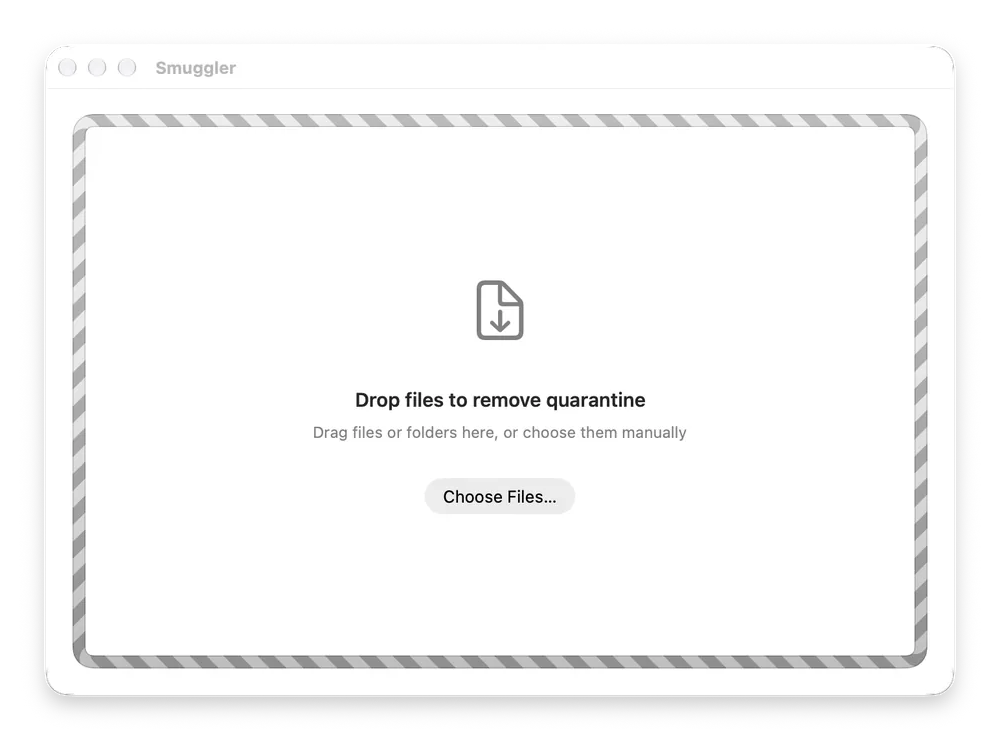
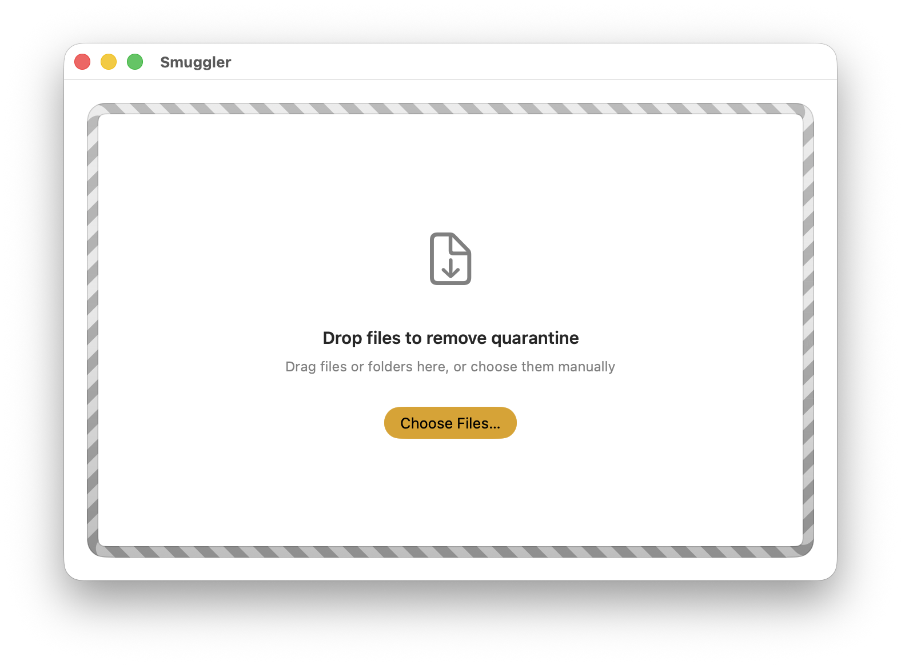
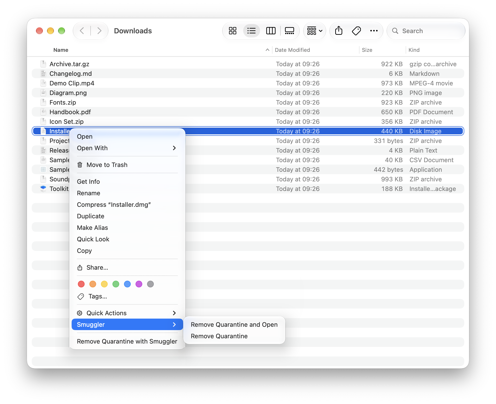

<div align="center">


<picture>
  <source media="(prefers-color-scheme: dark)" srcset="Docs/title-dark.png">
  
</picture>

**Free downloaded files from macOS quarantine. No Terminal, no `xattr`.**

[](LICENSE) [](#install) [](#built-with) [](https://github.com/benjaminhuebner/Smuggler/releases/latest)

[Website](https://smuggler.benjaminhuebner.com) · [Why](#why-macos-refuses-to-open-your-downloads) · [Three ways in](#three-ways-in) · [What it touches](#what-it-touches) · [Install](#install) · [FAQ](#faq) · [Support](#support) · [Built with](#built-with)

</div>



**Smuggler is a free, open-source macOS app that removes the `com.apple.quarantine` attribute from files and folders.** That attribute is the reason macOS refuses to open your downloads cleanly. Drag them into the window, right-click them in Finder or start Smuggler from the Services menu. It clears that one attribute and leaves everything else on disk untouched.

## Why macOS refuses to open your downloads

Files you download arrive with a hidden `com.apple.quarantine` attribute. That tag is what stands between you and the file:

- *"…is an app downloaded from the Internet. Are you sure you want to open it?"*
- *"…cannot be opened because the developer cannot be verified."*
- *"…is damaged and can’t be opened. You should move it to the Trash."* — which usually means nothing is damaged at all, only that the app is not signed the way Gatekeeper expects.

The usual fix is a command copied from a forum post:

```sh
xattr -d com.apple.quarantine ~/Downloads/Installer.dmg
xattr -dr com.apple.quarantine ~/Downloads/SomeFolder
```

Smuggler does the same thing by drag and drop. It removes that one attribute, writes nothing else and stays clear of jargon: no *extended attributes*, no talk of bypassing anything, just a row that reads *Freed — ready to use*.

## Three ways in

<table>
<tr>
<td width="50%" valign="top">
<a href="Docs/screenshots/drop-zone.png"></a>
</td>
<td width="50%" valign="top">
<a href="Docs/screenshots/finder.png"></a>
</td>
</tr>
<tr>
<td valign="top">

**The window.** Drop files and folders in, or pick them with <kbd>⌘O</kbd>. Drop as many as you like, and folders are cleared all the way down. Each item runs on its own: cancel one and the rest carry on, or stop the whole batch.

</td>
<td valign="top">

**Finder.** Right-click a file or folder and pick *Remove Quarantine* or *Remove Quarantine and Open* from the *Smuggler* submenu. The menu appears when at least one selected item carries the tag. Finder doesn't offer it inside iCloud Drive, a synced Desktop or Documents folder included, so use the window or the Services menu there.

</td>
</tr>
</table>

**The Services menu.** *Remove Quarantine with Smuggler* shows up in the Services menu wherever you have files selected, Finder included, and macOS asks you to confirm it before it runs. When it has to launch Smuggler, it stays out of the way: a small window shows progress, a notification tells you how it went, then Smuggler quits. If an item needs your attention, the window stays open so you can see why. If Smuggler is already running, the files land in its window instead.

## What it touches

Exactly one attribute, on the files you point it at. Nothing is moved, copied, renamed or altered in content, and nothing is opened unless you pick *Remove Quarantine and Open*, which asks first. Removing the tag gives the same approval macOS asks you for the first time you open a file — Smuggler just lets you give it up front.

Two refusals are deliberate:

- Smuggler refuses protected system folders (`/System`, `/usr`, `/bin`, `/sbin` and, inside `/Library`, the `LaunchDaemons`, `LaunchAgents` and `Extensions` folders) at every entry point, and any folder that contains one of them.
- It never follows symlinks, so an alias cannot smuggle a blocked path past that check.

> [!IMPORTANT]
> *Remove Quarantine and Open* asks before it launches anything. Any process on your Mac can call the `smuggler://` scheme, so a request that cannot prove it came from the Finder extension ends up in that confirmation dialog instead of quietly starting a binary.

## Install

Smuggler needs **macOS 26** or later.

Download `Smuggler.dmg` from the [releases page](https://github.com/benjaminhuebner/Smuggler/releases/latest), open it and drag Smuggler to `/Applications`. The app is signed with a Developer ID and notarized, and it updates itself through Sparkle. In Settings (<kbd>⌘,</kbd>) you choose whether it looks for updates on its own and whether it installs them without asking.

For the Finder menu, open System Settings → General → Login Items & Extensions and switch Smuggler on under Finder extensions.

> [!NOTE]
> Smuggler itself opens on first launch without any of the friction it exists to remove: it is notarized, so Gatekeeper lets it through. It will never appear on the Mac App Store, because clearing an attribute on arbitrary paths needs an app that is not sandboxed.

## FAQ

### Is it safe to remove the quarantine attribute?

It is the same approval macOS asks you for the first time you open a downloaded file, on the files you picked yourself. Nothing else about them changes. The judgement stays yours: clear what you downloaded on purpose, from a source you trust.

### Does Smuggler switch off Gatekeeper or SIP?

No. Gatekeeper, SIP and every other protection on your Mac keep running as before. Smuggler removes one attribute from the paths you hand it, refuses protected system trees at every entry point, and ships no command line tool and no scripting interface.

### Why not just run `xattr` in Terminal?

You can, and it does the same job. Smuggler is for the people who should not have to: nothing to copy, no path to type or escape, and no risk of running a command from a forum post that turns out to do more than it says.

## Support

Found a bug or have a question? Use the [support form](https://smuggler.benjaminhuebner.com/support) on the website, write to [hello@benjaminhuebner.com](mailto:hello@benjaminhuebner.com) or [open an issue](https://github.com/benjaminhuebner/Smuggler/issues) here on GitHub. In the app, the Help menu leads to the website and the support form, and *About Smuggler* lists the same addresses.

## Built with

Smuggler is a SwiftUI app in two bundles that share an app group: the unsandboxed app and a sandboxed FinderSync extension. That split is not optional — `removexattr()` on arbitrary paths requires no sandbox, and Finder extensions are always sandboxed. Third-party dependencies:

| Dependency | What it's for |
| --- | --- |
| [Sparkle](https://github.com/sparkle-project/Sparkle) | In-app software updates |

Everything else is Apple frameworks: Swift 6 under strict concurrency, SwiftUI with AppKit where the platform calls for it. The interface ships in English and German.

## License

[MIT](LICENSE) © 2026 [Benjamin Hübner](https://benjaminhuebner.com)
